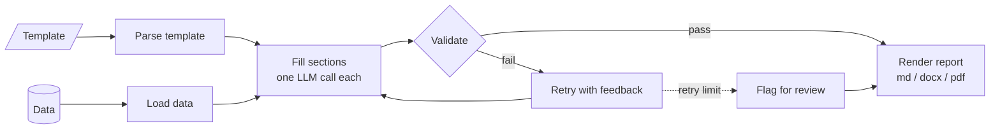

# template-report-llm

Fill structured report templates automatically using an LLM, grounded in your own data.

> **Status:** early development. The design and roadmap are below; code is being added in small, working steps.

## The problem

Many teams write the same kinds of reports again and again: audit findings, monthly summaries, compliance checks, project status. The layout stays the same every time. Only the content changes.

Writing these by hand is slow and inconsistent. Asking an LLM to "write the report" gives fluent text, but it often ignores the required structure, makes up numbers, or drifts from the source data.

## The idea

Keep the **template** in charge of structure, and let the **LLM** fill in only the parts that need writing.

1. You provide a template with named sections and placeholders.
2. The tool pulls the data each section needs (CSV, JSON, database query).
3. For each section, the LLM gets only that section's instructions and data.
4. The output is checked: required sections present, numbers match the source, no empty fields.
5. A finished report is rendered (Markdown first, then DOCX/PDF).



The full design, covering architecture, request flow, data model, design decisions and deployment, is in **[docs/system-design.md](docs/system-design.md)**.

## Design principles

- **Structure comes from the template, not the model.** The LLM never decides what sections exist.
- **Small prompts, one section at a time.** Easier to debug, cheaper, and less likely to drift.
- **Numbers come from data, not from the model.** Figures are inserted directly; the LLM writes the text around them.
- **Every output is checked.** Validation runs before anything is rendered.
- **Model-agnostic.** The LLM sits behind a simple interface so providers can be swapped.

## Template format (planned)

```markdown
# {{data:report_title}}

## Summary
<!-- llm: Write a 3-sentence summary of the findings below. Neutral tone. -->
{{section:summary}}

## Key figures
| Metric | Value |
|---|---|
| Total records checked | {{data:total_records}} |
| Exceptions found | {{data:exceptions}} |

## Observations
<!-- llm: List each exception with a one-line explanation. Use only the data provided. -->
{{section:observations}}
```

- `{{data:...}}` is filled directly from the data source, with no LLM involved.
- `{{section:...}}` is written by the LLM, using the instruction in the comment above it.

## Roadmap

**Phase 1: Core pipeline**
- [x] Parse templates into sections and placeholders
- [ ] Load data from CSV and JSON
- [ ] Fill `{{data:...}}` placeholders directly
- [ ] Fill `{{section:...}}` placeholders with one LLM call per section
- [ ] Render to Markdown

**Phase 2: Reliability**
- [ ] Validation: required sections, empty fields, number checks
- [ ] Retry failed sections with the validation error as feedback
- [ ] Structured output (Pydantic models) for list and table sections
- [ ] Logging of every prompt and response for debugging

**Phase 3: Usability**
- [ ] CLI: `report fill template.md --data data.json`
- [ ] FastAPI service with a simple upload endpoint
- [ ] DOCX and PDF output
- [ ] Database data sources (PostgreSQL)

**Phase 4: Quality**
- [ ] Evaluation set of sample templates and expected outputs
- [ ] Cost and latency tracking per report
- [ ] Support for local models

## Tech stack (planned)

Python, Pydantic, FastAPI, Jinja2, and an LLM provider behind a small adapter interface.

## Project structure (planned)

```
template-report-llm/
├── src/report_llm/
│   ├── template.py     # parse templates into sections
│   ├── data.py         # load data sources
│   ├── fill.py         # LLM section filling
│   ├── validate.py     # output checks
│   └── render.py       # markdown / docx / pdf output
├── docs/
│   └── system-design.md
├── examples/           # sample templates and data
├── tests/
└── README.md
```

## Development

```bash
pip install -e ".[dev]"
pytest
```

## License

MIT
