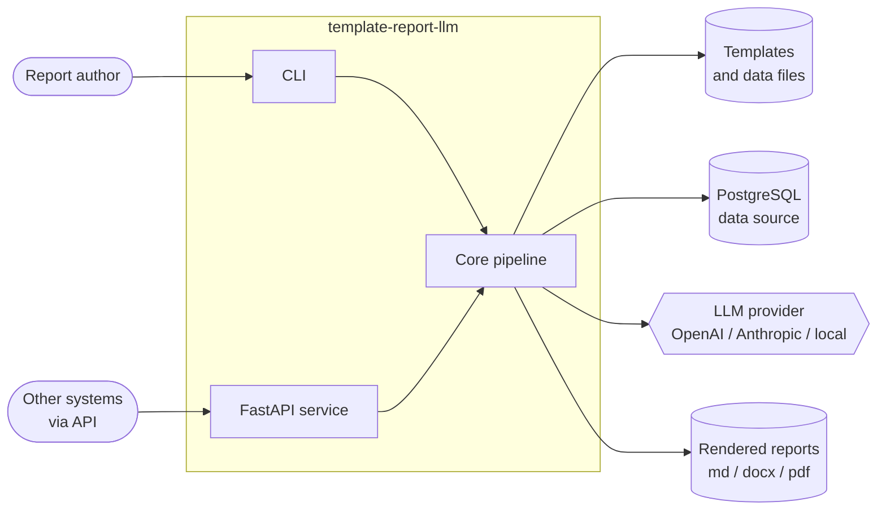
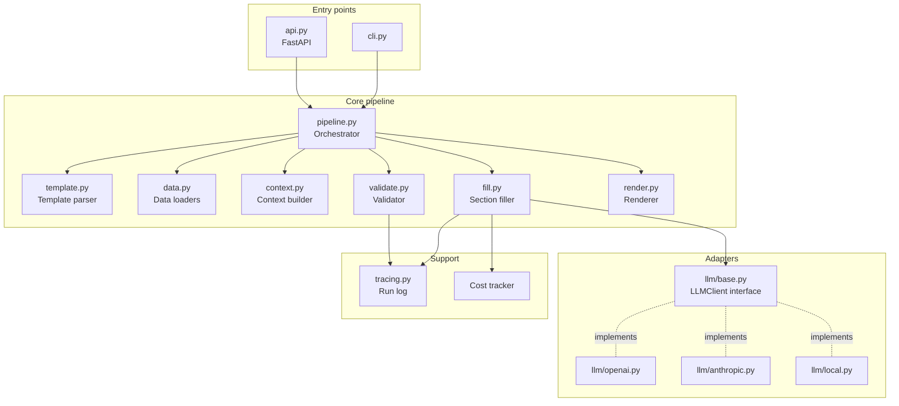
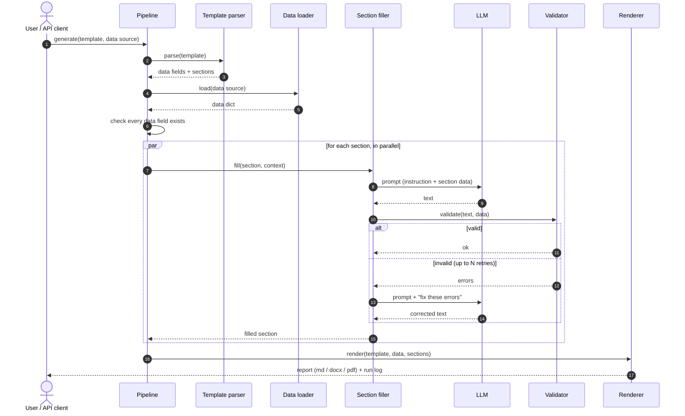
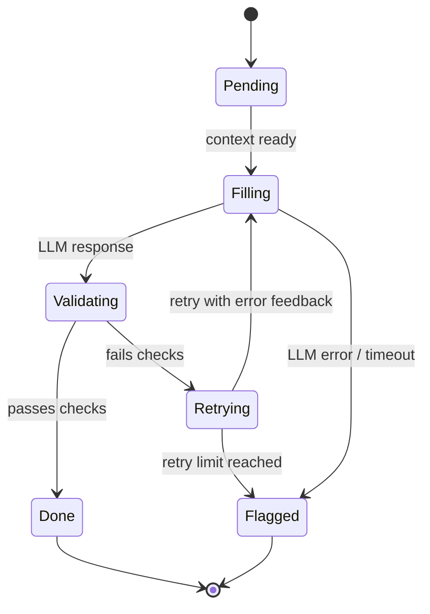
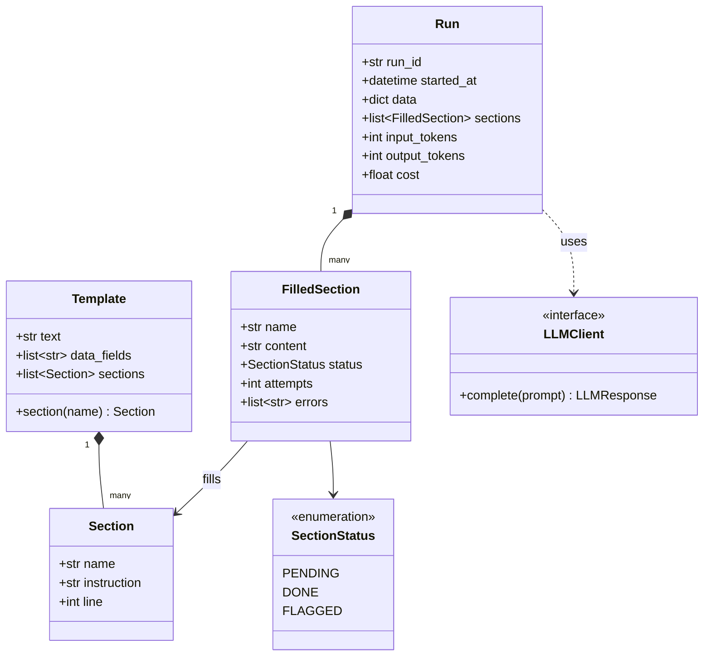
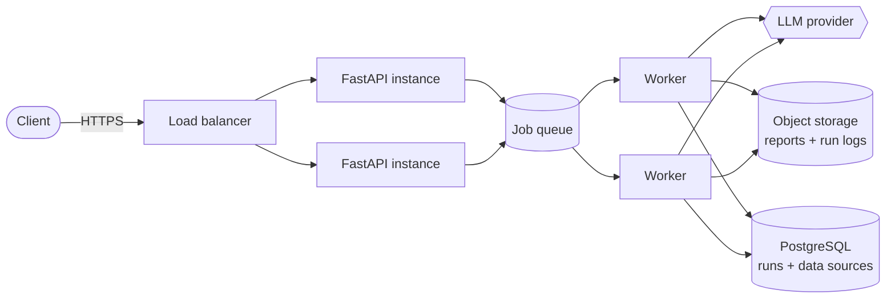

# System Design

This document describes how `template-report-llm` is designed: what it does, how the parts fit together, and the decisions behind them.

> **Status:** the template parser (`src/report_llm/template.py`) is implemented and tested. Everything else here is the planned design, and the roadmap in the [README](../README.md) tracks progress.

---

## 1. Goals and non-goals

**Goals**

- Turn a **template + data** into a finished report. The template decides the structure, and the LLM writes only the prose.
- Never let the model invent numbers. Every figure in the output must come straight from the data source.
- Make every step checkable: you can see which prompt produced which section, and why a section failed.
- Work with any LLM provider, including local models.
- Run as a **CLI** for one-off reports and as an **API service** for integration.

**Non-goals (for now)**

- A visual template editor.
- Free-form "write me a report" generation with no template.
- Real-time collaborative editing of reports.

---

## 2. Requirements

| Type | Requirement |
|---|---|
| Functional | Parse templates with `{{data:...}}` and `{{section:...}}` placeholders and `<!-- llm: ... -->` instructions |
| Functional | Load data from CSV, JSON, and (later) SQL queries |
| Functional | Fill data placeholders directly, and fill section placeholders with one LLM call each |
| Functional | Validate output before rendering, and retry failed sections with feedback |
| Functional | Render to Markdown, then DOCX and PDF |
| Non-functional | **Correctness:** numbers in the output match the source data exactly |
| Non-functional | **Traceability:** every prompt and response is logged with the run ID |
| Non-functional | **Cost control:** small prompts, one section at a time, with token and cost tracked per run |
| Non-functional | **Latency:** independent sections are filled in parallel |
| Non-functional | **Portability:** the LLM provider is swappable through one interface |

---

## 3. System context

Who and what the system talks to.

---

## 4. Component architecture

The core is a pipeline of small modules. Each one has a single job and can be tested on its own.

| Component | Responsibility |
|---|---|
| **Template parser** ✅ | Reads the template, finds data fields, sections, and the instruction that belongs to each section. Rejects malformed templates early. |
| **Data loaders** | Load CSV, JSON, or SQL results into one plain dictionary. |
| **Context builder** | For each section, picks only the data that section needs, so prompts stay small. |
| **Section filler** | Builds the prompt for one section and calls the LLM. Sections run in parallel. |
| **Validator** | Checks each filled section: not empty, follows the requested shape, and every number in it exists in the data. |
| **Renderer** | Substitutes data values and filled sections into the template, then writes Markdown, DOCX, or PDF. |
| **LLMClient interface** | One method, `complete(prompt) -> response`. Providers plug in behind it. |
| **Run log** | Records every prompt, response, validation result, and timing for a run. |

---

## 5. Request flow

What happens when a report is generated, end to end.

---

## 6. Section lifecycle

Each section moves through these states. A section that keeps failing is flagged, not silently dropped.

A flagged section is rendered with a clear marker (for example `[NEEDS REVIEW: numbers did not match data]`), so a person can fix it by hand. The report is never quietly wrong.

---

## 7. Data model

`Template` and `Section` are implemented. The rest are planned.

---

## 8. Key design decisions

**1. The template owns the structure, not the model.**
The model is never asked "write a report". It is asked "write this one section, using this data". It cannot add, drop, or reorder sections. This removes the most common failure of LLM-written reports.

**2. Numbers bypass the model.**
`{{data:...}}` placeholders are filled by plain string substitution. The validator also extracts every number from LLM-written text and checks it exists in that section's data. A model that writes "12 exceptions" when the data says 11 fails validation.

**3. One LLM call per section.**
- Smaller prompts are cheaper and keep the model focused.
- A bad section can be retried alone, without regenerating the whole report.
- Sections can run in parallel, so total time is close to the slowest section rather than the sum of all of them.
- Each failure points to one prompt, which makes debugging simple.

The trade-off is that sections cannot "see" each other. Where flow matters (for example a summary that depends on observations), the template can mark a section as depending on others, and it is filled after them with their text as context. *(planned)*

**4. Retry with feedback, then flag.**
A failed section is retried with the exact validation errors added to the prompt. After a fixed number of attempts it is flagged for human review instead of being rendered as if it were correct.

**5. Provider behind an interface.**
`LLMClient` has one method. Swapping OpenAI for Anthropic or a local model is a config change, which also makes testing easy, because tests use a fake client that returns fixed text.

**6. Fail early on bad templates.**
The parser rejects duplicate sections, orphan instructions, and (in the pipeline) data fields missing from the data source, before any LLM call is made and any money is spent.

---

## 9. Validation rules

| Check | Example failure |
|---|---|
| Not empty | Model returned only whitespace |
| Number grounding | Text says "12 exceptions", data says 11 |
| Shape | Instruction asked for a list, response is a paragraph |
| Length | Instruction asked for 3 sentences, response has 9 |
| No leftover placeholders | Response contains `{{...}}` |
| Structured output *(planned)* | List or table sections parsed into Pydantic models and type-checked |

---

## 10. Deployment (API mode)

- Short reports run directly in the request.
- Long reports go onto a queue. The API returns a job ID, and the client polls for the result or receives a webhook.
- Workers scale independently of the API, because LLM calls are the slow part.
- Reports and run logs go to object storage, while run metadata goes to PostgreSQL.

---

## 11. Observability and cost

Every run records:

- the run ID, template name, and data source;
- for each section: the prompt, response, attempts, validation errors, latency, and tokens;
- totals for the run: tokens, estimated cost, and wall time.

This answers the usual questions quickly: *why is this section wrong?*, *which template is most expensive?*, and *which sections fail validation most often?*

---

## 12. Security

- API keys come from environment variables and are never written to logs.
- Only the data a section needs is sent to the LLM, which limits what leaves the system.
- An optional redaction step masks fields marked sensitive before they are sent to the model. *(planned)*
- Local-model support means sensitive reports can be generated without data leaving the machine.

---

## 13. Testing strategy

| Level | What is tested |
|---|---|
| Unit | Parser, data loaders, validator rules, and renderer, with no LLM involved |
| Pipeline | Full runs with a fake `LLMClient` that returns scripted responses, including bad ones that trigger retries |
| Evaluation *(planned)* | A fixed set of templates and data with expected properties, run against real models to compare quality and cost |

---

## 14. Future work

- Section dependencies (fill the summary after the sections it summarises).
- Template inheritance and reusable partials.
- Caching LLM responses for unchanged sections and data.
- A small web UI to upload a template and data and download the report.
